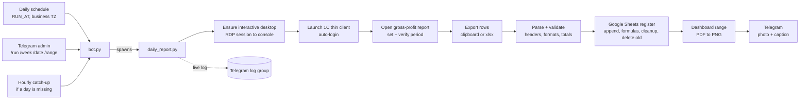

# 1C Daily Sales Report Bot

**An unattended robot that pulls yesterday's gross-profit report out of the 1C:Enterprise thin client, writes it into a Google Sheets register, renders the sales dashboard as an image and posts it to Telegram. The whole process is managed from a Telegram bot.**


## Overview

At a retail & fintech company in Uzbekistan, management starts every day with a "Sales by day" dashboard in a shared Google Sheets workbook. Keeping it up to date used to be a manual morning routine:

1. Open 1C:Enterprise and build the gross-profit report for yesterday.
2. Copy the rows into the workbook's "Register" sheet.
3. Drag the formulas down and delete the rows with no sales channel.
4. Screenshot the dashboard and send it to the team in Telegram.

This project automates the whole chain on a Windows server. 1C has no convenient API for this report, so the robot drives the real 1C thin client through **Windows UI Automation**, the same way a person would. It parses and cross-checks the exported data, writes it to Google Sheets in a crash-safe order, exports the dashboard range as a pixel-perfect image and sends it to the recipients. A Telegram bot keeps the daily schedule, catches up on missed days and lets admins re-upload any date or period with one command.

## Features

**1C automation**
- Starts its own thin-client instance with auto-login, picking the client version the infobase needs (from `ibases.v8i` or `.env`). It closes the instance afterwards and leaves other open 1C windows alone.
- Navigates *Sales → Sales reports → exact report variant*, sets the period and **verifies it against the report header**, so data for the wrong days is never written.
- Input does not depend on the cursor: it uses UIA patterns and window messages, so the physical mouse doesn't move during a run.
- Exports via the clipboard and waits until the clipboard stops growing. If the clipboard stays empty, it falls back to saving the report as `.xlsx`.
- A background watchdog dismisses stray 1C pop-ups. On a navigation failure the run restarts with a fresh 1C client.
- **Restores the interactive desktop.** If the RDP window was closed, Windows keeps the session alive but it has no desktop, and UI clicks silently do nothing. Before touching 1C, the robot moves the session to the console (`tscon … /dest:console`).

**Data validation**
- Columns are mapped **by header name**, not by position, because report layouts differ between 1C users.
- The decimal separator is detected **per column**, since a single export can mix `1 234,56` and `1,234.56`. Date order (`dd.mm.yyyy` vs `m/d/yyyy`) is detected from the data.
- Two hard stops: every non-empty number must parse, and the parsed sum must match the report's own **"Total" row**. A truncated or misparsed export aborts the run instead of corrupting the register.
- Wholesale client groups are excluded (configurable). Long periods are fetched in chunks (`MAX_CHUNK_DAYS`), and each chunk is verified separately.

**Google Sheets register**
- New rows are appended **first**, and only then are the old rows for the same dates deleted. If the run crashes halfway, no data is lost.
- Formulas are written directly to the new rows, so this works even when a filter is active on the sheet. Number and date formats are set explicitly, and dates are written as serial numbers so they behave the same in any locale.
- Rows whose sales-channel formula comes out empty are removed and **listed in the Telegram caption**, so nothing disappears silently.
- **Self-healing workbook formula.** New retail stores (`RETAIL_DIVISIONS`) and a missing marketplace branch are added to the channel formula automatically.
- Safety limits: no write when the report returns 0 rows, at most 5,000 deletions per run, and days that were in the register but came back empty from 1C are left untouched. When past days are re-uploaded, the caption reports which days changed and by how much.

**Dashboard image and Telegram**
- The dashboard block is **found automatically** by its header and "Total" row, even after colleagues insert rows above it. It is exported to PDF through Google's export endpoint and rasterized with PyMuPDF, so the picture shows the real sheet formatting.
- Picture + caption (revenue, gross profit, rows written) is sent to all recipients. If one recipient fails, the others still get the message.
- The progress of every run is streamed **live to a Telegram log group**, so problems are visible from a phone without logging into the server.

**Control bot**
- Admin and viewer roles. Admins start uploads, and viewers can only request the screenshot and the status.
- Daily schedule in the business time zone (independent of the server clock). An **hourly catch-up** runs if a day was missed.
- The report runs in a **separate process**, so long 1C automation never blocks the bot.
- A **polling watchdog** restarts the bot if Telegram updates stop being consumed. A restart loop (`start_bot.cmd`) brings it back.

**Ops and tests**
- PowerShell scripts for Task Scheduler setup, deployment, server install and the RDP console shortcut.
- Offline test scripts for number/date parsing, mixed formats, formula patching, screenshot-range detection, sheet logic, roles, navigation retries and the watchdog.

## How it works



## Tech stack

| Area | Tools |
|---|---|
| Language | Python 3.11+ |
| 1C automation | pywinauto (UIA backend), pywin32, comtypes, Win32 API via `ctypes` |
| Google | gspread, google-auth (service account), Sheets API, Drive export |
| Imaging | PyMuPDF (PDF rasterization), Pillow (crop, margins) |
| Telegram | python-telegram-bot 22 with `JobQueue`, plus raw Bot API calls via `requests` |
| Config | python-dotenv (`.env`), `zoneinfo` for the business time zone |
| Ops | Windows Task Scheduler, PowerShell, a hidden VBS launcher, optional NSSM |

## Project structure

```
1c-daily-report-bot/
├── bot.py                     # control bot: buttons, commands, schedule, catch-up, watchdog
├── daily_report.py            # orchestrator: period, 1C session, validation, Sheets, image, Telegram
├── src/
│   ├── config.py              # .env -> Config object
│   ├── clock.py               # "today"/"yesterday" in the business time zone
│   ├── gross_profit.py        # 1C report: navigation, period check, TSV parsing and validation
│   ├── reports.py             # 1C UI engine: report forms, filters, export, dialog watchdog
│   ├── virtual_input.py       # cursor-independent input (UIA patterns + window messages)
│   ├── onec_launcher.py       # find/launch/attach/close the 1C thin client
│   ├── onec_app.py            # attach to a 1C window by title
│   ├── desktop_session.py     # detect a disconnected RDP session and move it to the console
│   ├── sheets_register.py     # "Register" sheet: append, formulas, cleanup, safe deletes
│   ├── sheet_image.py         # locate the dashboard block, export PDF -> PNG
│   ├── telegram_send.py       # photo/text broadcast with retries
│   └── tg_log.py              # live run log streamed to a Telegram group
├── tools/
│   ├── check_setup.py         # environment self-check (key, sheet, header, bot, recipients, 1C)
│   ├── convert_to_gsheet.py   # convert an .xlsx on Drive into a native Google Sheet
│   ├── fix_group_formula.py   # preview/apply channel-formula fixes
│   ├── repair_formulas.py     # restore missing formulas after an interrupted run
│   ├── audit_register.py      # consistency audit of the register and dashboard
│   ├── test_*.py              # offline tests (parsing, formulas, screenshot range, roles, watchdog...)
│   └── *.ps1                  # scheduling, deployment, server install, RDP console shortcut
├── start_bot.cmd              # restart loop for the bot (runs in the interactive session)
├── start_bot_hidden.vbs       # start the bot without a console window
├── run_daily.cmd              # alternative: plain daily run without the bot
├── .env.example
└── requirements.txt
```

## Setup

**Requirements:** a Windows machine with the 1C:Enterprise thin client and access to the infobase, plus a Google Cloud service account with the Sheets API (and Drive API for the optional conversion tool) enabled.

```powershell
pip install -r requirements.txt
Copy-Item .env.example .env        # then fill it in
# put the service-account key at credentials/service_account.json
python tools/check_setup.py        # verifies everything before the first run
```

The register must be a **native Google Sheet**: the Sheets API cannot write to an `.xlsx` stored on Drive. Convert it with *File → Save as Google Sheets* or with `python tools/convert_to_gsheet.py`. Then share it with the service account's e-mail as **Editor**.

Every Telegram recipient has to press **Start** in the bot once, because Telegram doesn't let a bot message someone first. `/who` shows who is still unreachable.

**Configuration (`.env`)**

| Variable | Default | Description |
|---|---|---|
| `GOOGLE_CREDENTIALS_PATH` | `credentials/service_account.json` | Service-account key file |
| `REGISTER_SPREADSHEET_ID` | — | Native Google Sheet ID (or full URL) |
| `SOURCE_XLSX_FILE_ID` | — | Original `.xlsx` on Drive, only for `convert_to_gsheet.py` |
| `REGISTER_SHEET` / `REGISTER_HEADER_ROW` | `Регистр` / `20` | Register sheet and its header row |
| `SUMMARY_SHEET` / `SUMMARY_RANGE` | `Sales by day` / `A19:K34` | Dashboard sheet. The range is a fallback if the block isn't found automatically |
| `TELEGRAM_BOT_TOKEN` | — | Bot token from @BotFather |
| `TELEGRAM_CHAT_IDS` | — | Recipients of the daily picture (comma-separated) |
| `TELEGRAM_LOG_CHAT_ID` | — | Group for the live run log |
| `BOT_ADMIN_IDS` | — | Users allowed to start uploads |
| `BOT_VIEWER_IDS` | = recipients | Users allowed to request `/shot` and `/status` |
| `1c_login` / `1c_password` | — | 1C user for auto-login |
| `ONEC_CONNECTION_STRING` | placeholder | e.g. `ws=https://<1c-server>/<base>;`, used when the base isn't in `ibases.v8i` |
| `ONEC_CLIENT_VERSION` | newest installed | Thin-client version the infobase requires |
| `ONEC_IB_NAME` / `THIN_CLIENT_EXE_OVERRIDE` | — | Optional infobase name / explicit path to `1cv8c.exe` |
| `ONEC_WINDOW_TITLE` | `1С:Предприятие` | Substring of the 1C main window title |
| `ONEC_REUSE_OPEN` | `0` | `1` = attach to an already open 1C window |
| `REPORT_SECTION` / `REPORT_MENU_ITEM` / `REPORT_TITLE` | Sales report defaults | Where the report lives in the 1C UI |
| `EXCLUDE_CLIENT_GROUPS` | `B2B,B2B new,optom` | Client access groups excluded from the register |
| `RETAIL_DIVISIONS` | empty | Retail stores to add to the channel formula |
| `TIMEZONE` | `Asia/Tashkent` | Business time zone for "yesterday" and the schedule |
| `RUN_AT` | `06:30` | Daily run time |
| `MAX_CHUNK_DAYS` | `7` | Max days per 1C report |
| `WEEKLY_REFRESH_WEEKDAY` | `0` | Day to re-upload the last 7 days (`0`=Mon … `6`=Sun, `-1` = off) |
| `VIRTUAL_INPUT_ALLOW_REAL` / `VIRTUAL_INPUT_DEBUG` | `0` | Allow real mouse/keyboard input / log the input layer used |

## Usage

**Command line**

```powershell
python daily_report.py                                   # as scheduled: yesterday (or the weekly refresh)
python daily_report.py --date 19.09.2026                 # one day
python daily_report.py --from 14.09.2026 --to 19.09.2026 # a period, fetched in chunks
python daily_report.py --weekly                          # force re-upload of the last 7 days
python daily_report.py --dry-run                         # 1C export + validation only, no writes
python daily_report.py --no-telegram                     # write to Sheets, don't send
python bot.py                                            # start the control bot
```

**Telegram bot**

| Button / command | Who | Action |
|---|---|---|
| ▶️ Обновить за вчера · `/run` | admin | Regular run for yesterday |
| 🗓 Перезалить неделю · `/week` | admin | Delete and re-upload the last 7 days |
| `/date 19.09.2026` | admin | One specific day |
| 📅 За период · `/range 14.09.2026 19.09.2026` | admin | Any period (or just send two dates) |
| `/month 9 [2026]` | admin | Re-upload a whole month (up to yesterday) |
| 📸 Скриншот · `/shot` | viewer | Current dashboard image, without touching 1C |
| 📊 Статус · `/status` | viewer | Running job, next run, desktop state, last date in the register |
| `/who` | admin | Which recipients the bot can actually reach |
| ⏹ Остановить · `/stop` | admin | Stop the current run and close its 1C instance |

**Running on a server**

```powershell
powershell -ExecutionPolicy Bypass -File tools\setup_schedule.ps1      # bot starts at logon, keeps RUN_AT itself
powershell -ExecutionPolicy Bypass -File tools\setup_rdp_console.ps1   # "disconnect but keep desktop" shortcut
```

The bot runs in the **interactive user session**, not as a Windows service: services live in session 0, which has no desktop, so the 1C client can't open there. `deploy_to_server.ps1` and `install_on_server.ps1` package the project, copy it to the server, install dependencies, run the self-check and register autostart.

## Security note

- No secrets are stored in the code. Tokens, chat/user IDs, the spreadsheet ID, 1C credentials and the 1C server address are read from **`.env`**. The Google service-account key lives in **`credentials/`**. Both are excluded by `.gitignore`, and only `.env.example` with placeholders is committed.
- Logs, raw report exports (`out/`), screenshots and the 1C PID file are git-ignored as well.
- The robot only **reads** 1C reports and never modifies 1C documents.
- Business-specific names in comments and tests (stores, marketplaces, counterparties) have been replaced with neutral placeholders.

---

**Кратко по-русски:** робот каждое утро сам открывает 1С (через UI Automation, не трогая мышь), формирует отчёт «Валовая прибыль» за вчера и проверяет его по шапке и строке «Итого». Затем дописывает строки в лист «Регистр» Google-таблицы, снимает картинку дашборда «Sales by day» и рассылает её в Telegram. Управление идёт через Telegram-бота: расписание, догоняющий запуск, перезалив дней и периодов, роли администратора и наблюдателя.
